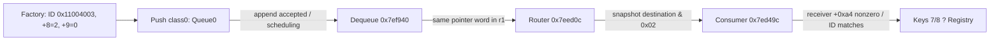

## Phase 4.15 current Request delivery conditions

The SHA-pinned primary ELF disproves Queue1 as the initial Request path.
Factory `0x7f0b0c` supplies constructor `0x7f17f8` with r1=0x11004003,
r2=2 and r3=0. Stores `0x7f17fc`, `0x7f1800`, `0x7f1802` initialize
Event destination byte +8=2, queue-selection byte +9=0 and ID word +4.
The byte +9 source-level name remains UNKNOWN. Class0 selects Queue0
append at `0x7ef9e0`, bypassing main callback `0x7ef988` and Queue1.
Local setParamList/addParameter/submission wrappers do not alter +8/+9;
interposition, corrupted aliases and later mutations remain conditions.

Router mask is numeric **0x02 (bit index 1)**, not 0x04. Event::getDest
reads +8; Event::setDest at `0x10f9f8` overwrites that byte. Router retains
a destination snapshot in r6, then passes the original Event in r1 at
`0x7eedf0`. Request destination2 satisfies the initial mask, but Consumer
also requires receiver word +0xa4!=0 at `0x7ed4b2/0x7ed4b8` via helper
`0x7eaa14`; the word's full semantic role and runtime value are UNKNOWN.
The ID getter and literal-minus3-plus1 comparison identify 0x11004003,
then key7/8 extraction and Registry lookup reuse the existing primary proof.

Fresh register-origin analysis independently recovers factory ctor constants,
transfer `0x7ef92a r0 -> 0x7ef92e r1 -> 0x7ef932 append`, and application
block `0x7eefda r0 -> 0x7eefde r1 -> 0x7eefe2 Router`. The pointer word
remains unknown numerically; its producer/copy provenance is established.
Transfer moves at most one Event per invocation, under count/loop guards,
and is not required for this initial Request. Queue0 and Queue1 are separate
objects at state+0 and state+4, not the EventManager callback fields.

Pop removes a list node and returns its Event pointer. Append refuses null
or duplicate pointers. Transfer and dequeue do not release Event ownership
in the inspected bodies; allocation exceptions and locking results remain
limitations. Router destructs/deletes Event after handlers, so the consumer
receives a borrowed pointer. Scheduling, same-owner identity, successful
append, valid aliases and receiver/registry state remain CONDITIONAL.

The machine-readable eligibility result is generated by
`probe_request_event_eligibility()` and integrated into the existing chain
probe. Its offline model never claims runtime delivery. New graph facts:
one direct Queue0 append call and two pointer-flow relations. Counts are
57 -> 60 tracked, 47 -> 50 primary, inferred5 and unresolved5 unchanged.
This is three new relations, not an SDK completion percentage.
Runtime Verified and Safe-to-Invoke APIs remain0. No new Ghidra execution
is claimed; prior profiles are retained and current proof uses Capstone,
ELF symbol/relocation and bounded register dataflow.

Next targets: actual writer/meaning of receiver +0xa4 (reference0x7eaa14),
Registry record gate at0x7ed606, and conditional ModelCamera runtime identity.

## Phase 4.14 checkpoint

Primary ELF verifies a pre-enqueue callback at 0x11130c (96 reachable
instructions, 28 blocks). Its descriptor arm admits 0x11013008, not request
0x11004003; optional hook cell 0x10a8c6c remains unknown. AppConfig name
comparison and singleton/vtable selection are explicitly conditional.
The queue-transfer/dequeue/application-loop path reaches Router entry
0x7eed0c; 0x7eedf0 is its generic-consumer callsite. Six direct edges were
added: primary 41 -> 47, inferred 5, unresolved 5; tracked 51 -> 57.
Runtime/safe-callable APIs remain 0. See EVENT_MANAGER_PROVIDER_STATUS.md
for addresses, prerequisites, corrected imports and the next investigation.
No new Ghidra execution is claimed; profile is prepared.

## Phase 4.13 correction ? current evidence takes precedence

The Phase 4.11/4.12 BSS-provider premise is disproven. Thumb ADD at
0x7ef1f6 uses PC 0x7ef1fa; literal 0x83d9d6 gives base 0x102cbd0.
Adding 0x5068 gives 0x1031c38, not 0x1032238. Its unique R_ARM_GLOB_DAT
relocation names getConfig. The load/call has one indirection and does not
read 0x10a8930. Historical records below are retained as superseded evidence.

Primary ELF re-read verifies getConfig -> singleton 0x10a8a9c;
initializeConfig store 0x106dbc; constructor vptr store 0x106c98 ->
0xfe9b70; slot +0x30 at 0xfe9ba0 -> 0x106900; GOT 0x1030f6c with
R_ARM_RELATIVE pointer 0x11130d -> callback entry 0x11130c.
This is a conditional static chain: AppConfig.so branch, successful
initialization, local symbol binding and unchanged object identity are
required. Main dispatch is not unconditionally resolved, and the route from
0x11130c to Application Router 0x7eedf0 remains unknown.

The requested 0x10a8930 writer has not been established, but it no longer
blocks this provider path. No runtime or safe-to-invoke API was added.
Tracked graph remains 41 primary / 5 inferred / 5 unresolved, total 51.

# Camera Core Request → Event → ModelCamera 狀態

本文件是目前 Camera Core 端到端研究狀態的單一摘要。資料來自
`fwplatform.camera_core_chain` 對 SHA-256 固定的 Sony ILCE-6000 3.21
`libObj.so` 私人副本所做的有界 Capstone 讀取；原始韌體位元組、反編譯
文字和私人資料庫沒有放入 repository。

## 已由原始 ELF 證明的連接

| 連接 | ELF VMA / callsite | 等級 |
|---|---|---|
| `ViewBase::requestModelExecute` → request Event factory | `0x121098` → `0x7f0b0c` | `PRIMARY_ELF_VERIFIED` |
| `viewManagerIf::requestModelExecute` → request Event factory | `0x1250ee` → `0x7f0b0c` | `PRIMARY_ELF_VERIFIED` |
| ViewBase factory result → `View::requestApplicationExecute` | `0x1210a4` → `0x7f1b0c` | `PRIMARY_ELF_VERIFIED` |
| factory → Event `0x11004003` | literal locator `0x7f0b74` | `PRIMARY_ELF_VERIFIED` |
| factory → request keys 7 and 8 | `0x7f0b44`, `0x7f0b5c` | `PRIMARY_ELF_VERIFIED` |
| `View::requestApplicationExecute` → `Event::addParameter` key 6 | `0x7f1b2a` | `PRIMARY_ELF_VERIFIED` |
| View submit helper → `EventManager::push` | `0x7f25ec` → `0x7ef960` | `PRIMARY_ELF_VERIFIED` |
| selector `0x0f01` → `ModelCamera::pvt_ActionSetInit` | `0x4cfe98` → `0x4cf7a8` | `PRIMARY_ELF_VERIFIED` |
| `pvt_ActionSetInit` → EE-neutral / `PrepChk` | `0x4cf814`, `0x4cf81a` | `PRIMARY_ELF_VERIFIED` |
| EE-neutral → sender candidate `0x443d14` | `0x4b1a42` | `PRIMARY_ELF_VERIFIED` |
| owner candidate → provider helper candidate `0x7ef1e4` | `0x7ef268` | `PRIMARY_ELF_VERIFIED` |
| owner candidate `0x7ef254` → layout initializer `0x7ef894` | `0x7ef2ca` | `PRIMARY_ELF_VERIFIED` |
| owner candidate → `EventManager::push` | `0x7ef35a` → `0x7ef960` | `PRIMARY_ELF_VERIFIED` |
| layout initializer → provider vtable slot `+0x30` | `0x7ef8b0` | `PRIMARY_ELF_VERIFIED` |
| layout initializer → push dispatch state `+0x08` | `0x7ef8b2` | `PRIMARY_ELF_VERIFIED` |

The integrated probe currently emits **39 verified static edges** and **5
unresolved edges**.  Every verified edge carries the pinned binary hash,
`ELF_VMA`, source/callsite address, evidence method and verification status.

The five new setup edges are bounded owner/initializer observations.  They
prove object-field writes, a unique PLT binding to `EventManager::push`, and
the provider vtable slot used to populate the later indirect dispatch state.
They do not identify the callback target or prove that this owner is the
ModelCamera event consumer.

The latest bounded provider audit records a separate candidate path.  The
anonymous initializer at `0x45f2fc` writes the vtable address point
`0x1007528`, whose RTTI name bytes decode to `11AppConfigAC`.  Its `+0x30`
slot at `0x1007558` resolves through an `R_ARM_RELATIVE` word to
`0x45ee64`; that method loads another relocated word and returns the Thumb
address `0x45ee5c`.  The `0x45ee5c` body is only a `push/add/pop` leaf and
contains no event-consumer call.  The name helper has a separate external
`getConfig` branch, and the owner input selecting either branch is not proven.
Therefore this is a `PRIMARY_ELF_VERIFIED` candidate observation with
`STATIC_INFERRED` scope, not an EventManager callback edge or a ModelCamera
connection.

The executable-PT_LOAD literal inventory found `0x11004003` at `0x463448`,
`0x4637e4` and the factory literal at `0x7f0b74`.  This is an address inventory
only: matching a 32-bit word does not identify a receiver or prove a dispatch
edge, so the ModelCamera consumer remains `UNKNOWN`.

## 尚未接通的關鍵邊

- `EventManager::push` invokes `[this + 0x08]`, passing
  `r0=[state + 0x04]` and `r1=Event*`; the callback target is
  unresolved.
- The owner candidate at `0x7ef254` allocates a `0x24`-byte layout, invokes
  the bounded initializer at `0x7ef894`, stores it at owner `+0x10`, obtains
  an event through provider vtable slot `+0x2c`, and calls the uniquely bound
  `EventManager::push` PLT entry with `r2 = 1`.
- The initializer obtains an indirect factory result from provider vtable
  slot `+0x30` and stores it at `EventManager +0x08`, which is the field read
  by the dispatch site.  The slot target and eventual callback remain
  `UNKNOWN`.
- The optional completion path invokes a callback from `[this + 0x04]`; its
  target and ABI are unresolved.
- The generic consumer now proves receiver-side extraction of keys 7/8.
  Its registry entry and actual ModelCamera virtual target remain UNKNOWN.
- `0x12d780` is called by both request frontends and returns in `r0`, but its
  selector semantics remain `UNKNOWN`.
- UI/application submission and Camera prepare/action paths are proven static
  paths, not proof that UI ready, Camera Prepare, Camera Ready, or first-shot
  readiness has been reached.

Accordingly `event_consumer_model_camera`,
`event_keys_7_8_to_model_camera`, indirect callback targets, runtime
verification, and callable SDK status remain `UNKNOWN`/`false`.

## SDK 與可重現命令

- `sdk/camera_core_3_21.json` stores the sanitized relation contract.
- `sdk/camera_core_3_21.hpp` stores descriptive register/field observations;
  it is not a callable wrapper.
- `fwplatform/camera_core_chain.py` is reusable for the same evidence batch;
  it does not hard-code a fabricated event consumer.
- CLI: `python -m fwplatform.cli sdk camera-core-chain --elf <private-libObj.so> --json`
- Private Ghidra targeted profile: `camera-request-chain` in
  `ghidra-scripts/ParamListTargets.java`.  Its `-noanalysis` export is a
  cross-check only; it must not be counted as whole-program Auto Analysis.

The private Ghidra 12.1.3 run for that profile exited 0 with
`COMPLETE_TARGET_EXPORT`: 12 targets, 324 instruction rows, 26 blocks and 97
CFG/flow edges.  The exported program uses `ARM:LE:32:v8`, image base
`0x10000`, and Ghidra `ram` address space.  `auto_analysis_completed=false`
is retained; the raw export and project remain private.

## 驗證

The fail-closed camera-chain tests in
`tests/test_camera_core_chain.py` pass.  They reject binary identity errors,
missing evidence, callable promotion and promotion of the unresolved
ModelCamera consumer.  No runtime or hardware test was performed.

## Generic request consumer — current breakthrough

`0x7ed49c` calls `Event::getId` at `0x7ed4aa` and retains the result
in r6. Literal `0x11004005` at `0x7ed750` is reduced by 3 then increased
by 1 before comparison at `0x7ed4fe`. Equality branches at `0x7ed502`
to `0x7ed5c8`. This proves the computed request-ID comparison, rather
than merely a matching literal or a guessed function name.

| Proven connection | Callsite/dataflow | Grade |
|---|---|---|
| Application event router → generic consumer | `0x7eedf0` → `0x7ed49c`, destination bit 2 | PRIMARY_ELF_VERIFIED |
| Consumer → key 7 lookup | `0x7ed5d4` → `0x7ea918`; word getter `0x7ed5da` | PRIMARY_ELF_VERIFIED |
| Consumer → key 8 lookup | `0x7ed5ea` → `0x7ea918`; word getter `0x7ed5f2` | PRIMARY_ELF_VERIFIED |
| key 7 → registry lookup | `0x7ed5fc` → `0x7eb8fa`, r1=model identifier | PRIMARY_ELF_VERIFIED |
| key 8 → new Event ID | r1=sb at `0x7ed624`, constructor `0x7ed62a` | PRIMARY_ELF_VERIFIED |
| Registry result/new Event → model forwarder | `0x7ed650` → `0x7f124a`, r0=model, r1=Event | PRIMARY_ELF_VERIFIED |
| Forwarder → execution candidate | `0x7f1252` → `0x7efcca`, Event store at receiver +0x14 | PRIMARY_ELF_VERIFIED |

Missing key 7 uses `0xffffffff`; missing key 8 leaves zero. A null registry
result or out-of-range model ID follows another branch. The original
ParamList passes through copy-constructor candidate `0x7eda9c` before
`Event::setParamList`; ownership and concurrent aliases remain UNKNOWN.

The other literal regions have EHABI intervals `0x4633a0..0x46344c`
and `0x46364c..0x4637f4`. Inspected creation/insertion paths are producer
witnesses. EHABI intervals are boundary metadata, not complete CFG proof.

## Provider source and next missing intersection

Direct caller `0x7ed996` creates the owner on its stack and passes a name
pointer into BSS at `0x10df828`; its contents are UNKNOWN. `getConfig`
has local symbol entry `0x106c6c`; `initializeConfig` at `0x106da8`
creates the object through `0x106c7c`. Both use singleton `0x10a8a9c`.
Candidate vtable address point `0xfe9b70` has slot +0x30 at `0xfe9ba0`
pointing to `0x106900`, which returns GOT-relocated callback candidate
`0x11130c` via `0x1030f6c`. Owner-name selection and runtime symbol
interposition remain UNKNOWN; this does not resolve the actual push callback.

The registry writer, descriptor loader and Camera slots are now linked
conditionally below. A particular request's successful loader resolution
and selected registry instance remain unverified.

Private targeted Ghidra `camera-consumer-chain` exited 0 with
`COMPLETE_TARGET_EXPORT`: 11 targets, 480 instructions, 107 blocks,
231 flow references. Language `ARM:LE:32:v8`, image base `0x10000`,
space `ram`; Auto Analysis was not run. Forced bounded bodies are
cross-check ranges, not proof of source-level function extents.

Overall status: PARTIAL. Generic request consumption is proven; five
Camera/provider/normalization links remain unresolved. Fully verified
callable core APIs: **0**. Raw exports remain private.

## Model Registry → Camera：有前置條件的靜態鏈

`0x7eb8fa` searches the tree at receiver +0x88 through `0x7eb8f0`
and `0x7eb896`. The node payload starts at +0x10; key is +0x10 and
the returned record pointer is +0x14. End-iterator comparison yields a
zero result on miss. Registration `0x7ec8a4` checks for an existing key,
allocates a 0x24-byte record, initializes it at `0x7f1156`, and inserts
it via `0x7ec954 → 0x7ec6cc`. Duplicate entries skip this allocation path.
The registry is initialized in `0x7ec384`; cleanup/removal witnesses at
`0x7ec274` and `0x7ec476` are scoped observations, not a complete concurrent
ownership contract.

The configuration witness at `0x40208c..0x4020a3` supplies
`@M00B`, `modelCamera.so`, and `ModelCameraToInstance` to `IdSoTable::add`.
The compact ID parser `0x12d71a..0x12d744` interprets the final three
hexadecimal digits, giving **Model ID 11**. This identifies configured
metadata; it does not establish that initialization ran on a device.

The record has library string at +0x10, factory symbol string at +0x14,
loader handle at +0x18, instance at +0x1c, and context at +0x20.
`0x7f11ca` performs dlopen/dlsym and invokes the returned symbol at
`0x7f11f2`; its result is stored at +0x1c (`0x7f11f4`). Failed steps
take the cleanup path. The available extracted directory contains no
`modelCamera.so` file or preserved symlink proving its alias to `libObj.so`.
A read-only directory walk of the original ext-family root image also
found no such name: 29 directories / 744 entries. Image SHA-256:
`938daf4f8ed2bec72497a8f992d565832517de1311357eb79064869b6d183a99`.
Its `/lib/libObj.so` inode 135903 (inode record offset 0x8801f00) reconstructs
to the pinned ELF SHA-256. This excludes a lost symlink in that image only;
other mounted filesystems, runtime aliases or loader name rewriting remain
unverified. Library alias identity therefore remains UNKNOWN.

Phase 4.8 instruction-level loader dataflow confirms internal helper calls and
field flow without claiming imported API identity: `0x7f11d8` calls internal
helper `0xe0cec` with record `+0x10`, and stores its result at `+0x18`
(`0x7f11dc`); `0x7f11e6` calls internal helper `0xdfed0` with the handle and
record `+0x14`; `0x7f11f2` calls the returned function pointer with record
`+0x20` in `r1`; and `0x7f11f4` stores the factory result at `+0x1c`.
Separate `dlopen`/`dlsym` PLT candidates exist, but the helper-to-PLT
relationship is not proven. Registration reaches the record initializer at
`0x7ec91c`.
Null handle, symbol, dlsym result and instance branches remain explicit
failure paths. The selected DSO, registry key-to-instance mapping and
ModelCamera vtable identity remain `UNKNOWN`.

The SHA-pinned ELF does export `ModelCameraToInstance` at `0x4c8c64`:
it allocates 0x27d4 bytes, calls `0x4c8af4`, stores context at +0x20,
and returns the allocation. The initializer writes vptr **0x100a330**
at `0x4c8b10`; its typeinfo `0x100a31c` references RTTI name
`11ModelCamera`. These are direct static facts.

| Conditional Camera vtable relation | Slot / target | Evidence |
|---|---|---|
| Executor checker bridge | +0x08 → `0x1326fc` | slot `0x100a338`; call `0x7efc50` |
| Checker | +0x40 → `0x4acf80` | slot `0x100a370`; call `0x13271c` |
| Action bridge | +0x14 → `0x131cf6` | slot `0x100a344`; call `0x7efca6` |
| Action dispatcher | +0x44 → `0x4d02e4` | slot `0x100a374`; call `0x131d0a` |
| Final callback | +0x18 → `0x132624` | slot `0x100a348`; call `0x7efce0` |

The slot words and R_ARM_RELATIVE records are PRIMARY_ELF_VERIFIED.
The five instance-specific call edges are separately stored as
**STATIC_INFERRED**, conditioned on the receiver having this factory's
vptr. The final +0x18 callback is not the Action entry: Action executes
earlier in the TBB state machine. State 1 selects `0x7efc3a`; state 4
selects `0x7efc9a` and passes pending action field +0x10.

## Phase 4.8 EventManager completion callback provenance

The completion callsite at `0x7ef9ce` reads `EventManager +0x04` and invokes
it only when the incoming `r2` flag is non-zero. The owner initialization path
loads a Thumb pointer from relocated slot `0x1031894` (`R_ARM_RELATIVE`, stored
value `0x7eeb25`), yielding entry `0x7eeb24`. The bounded body is an
error/termination path (`write`, `__errno_location`, `fprintf`, `exit`), so it
is retained as `STATIC_INFERRED` callback provenance and explicitly excluded
as a ModelCamera consumer. Provider selection, activation conditions and
runtime object identity remain unresolved; the main dispatch at `0x7ef988`
and ModelCamera consumer are still `UNKNOWN`.

## Selector、Event ID 和 Action index

For compact `@M00B`, `0x12d840 → 0x120168` encodes a selector with no
bits above bit 11 as `0x12000000 + (11 << 12) + selector`.
Already encoded selectors are returned unchanged. Thus input **0x0f01**
produces Model Event ID **0x1200bf01**, distinct from request
Event ID **0x11004003**.

`0x131fd2` looks up the Event ID through the +0x24 mapping object and
subtracts the matching model prefix. Mapping aliases/completeness are
not fully audited. The checker must pass `0x131cd0 == 1`, and the audited
state branch requires Camera state 2. Its compare at `0x4ad242` reaches
`0x4adafc`, writing **Action index 25** through the forwarded output
pointer. The TBH word at `0x4d0326` maps index 25 to `0x4d04a4`;
tail branch `0x4d04a8` reaches `ActionGpSetSetting` (`0x4cfb9c`).
The independently verified selector arm then calls `pvt_ActionSetInit`.

The offline Python arithmetic model and ARM32 descriptive header preserve
these namespaces and expose no executable camera wrapper. Borrowed Event
at instance +0x14, ParamList aliases, current state, loader success and
threading requirements remain necessary ABI constraints.

## 本輪交叉驗證與下一個阻礙

Two private Ghidra 12.1.3 profiles completed with exit 0 and explicit
completion markers: registry (15 targets / 317 instructions / 46 blocks /
135 flow references), selector (11 / 148 / 35 / 54). Both are targeted
`-noanalysis` cross-checks. Two earlier registry attempts returned process
exit 0 but had a script decompiler timeout and no completion marker;
they are recorded INCOMPLETE. The final registry export explicitly skips
decompilation of its truncated TBH header while retaining instructions/CFG.
Capstone and original table words independently verify that table.

Current graph: **39 primary static edges, 5 conditional inferred edges,
5 unresolved edges**. End-to-end status remains PARTIAL. The next decisive
input is original filesystem symlink/loader metadata for `modelCamera.so`;
then audit the descriptor initialization state and Event-filter mapping
for `0x1200bf01`. EventManager provider selection and completion handoff
also remain UNKNOWN. No runtime verification or callable API was added.

## Phase 4.7 loader audit

The pinned ELF contains the configured `modelCamera.so` and
`ModelCameraToInstance` strings, and the factory symbol is present. A bounded
search of the authorized extracted filesystem found no separate
`modelCamera.so` file. This excludes one candidate file but does not prove the
runtime DSO alias, loader selection, or registry instance identity. Graph
counts remain 39 primary, 5 inferred and 5 unresolved.

## Phase 4.9 evidence integrity checkpoint

The loader helper probe now verifies the ARM veneer bytes at `0xe0cec` and
`0xdfed0` and rejects fabricated or operand-mismatched fact records. The
EventManager completion callback validator likewise requires the relocation,
stored Thumb pointer, callsite and first callback instruction. Main dispatch
at `0x7ef988` remains an unresolved indirect target; the completion pointer at
`0x7eeb24` is retained only as a static error/termination candidate and is not
classified as a ModelCamera consumer. Counts remain 39 primary, 7 inferred,
5 unresolved; runtime-verified and safe-to-invoke APIs remain zero. The two
loader helper edges are now promoted to PRIMARY_ELF_VERIFIED after direct GOT
and relocation resolution, so the current count is 41 primary and 5 inferred.

The bounded provider audit additionally confirms the main dispatch ABI:
`EventManager::push` passes `callback([state + 0x04], Event*)`. The pointer is
returned by provider vtable slot `+0x30` at initializer `0x7ef8b0` and stored
at `EventManager +0x08`; the provider getter itself uses a runtime-initialized
BSS function pointer, so no unique callback implementation can be claimed
from this ELF alone. This is a narrowed UNKNOWN edge, not a ModelCamera edge.

## Phase 4.11 provider getter / BSS audit

The SHA-pinned primary ELF probe confirms the getter body at `0x7ef1e4`.
Its `0x7ef234`/`0x7ef23a`/`0x7ef23c` instructions load a table offset and
indirectly call the function pointer at table slot `0x1032238`; the slot has
an `R_ARM_RELATIVE` relocation whose initial pointer value is the BSS cell
`0x10a8930`. The getter's `+0x30` provider vtable result is therefore a
runtime-initialized callback source, not a statically identified target.

A bounded executable-literal scan found no direct writer for `0x10a8930`.
This is explicitly a coverage-limited negative result: PC-relative stores,
register-derived aliases and external DSO writers were not proven absent.
The `.init_array` section is present (`0xfd25a4`, 1052 bytes), but no
constructor-to-slot write is established. Main dispatch `0x7ef988` remains
`UNKNOWN`; its static ABI remains `callback([state + 0x04], Event*)`.
Runtime provider identity, AppConfigAC selection, and ModelCamera delivery
remain unresolved. No edge was promoted and runtime/safe-callable counts stay
zero.

## Phase 4.16 receiver and registry checkpoint

The pinned ELF re-read verifies `0x7eaa14` as a four-byte object-relative
getter: it loads `[r0+0xa4]`, compares the word with zero, and returns a
normalized 0/1 value. Consumer callsite `0x7ed4b2` passes its `r4` receiver;
zero branches to `0x7ed8d8`. The field's source-level meaning and the runtime
identity of that receiver remain UNKNOWN.

The same ELF proves a generic state setter at `0x7eb118`, with store
`0x7eb12a` writing caller `r1` to caller `r0+0xa4`. Five bounded callers pass
`0x40000`, `0x30000`, `0x70000`, `0x50000`, and `0x40000`. These are
receiver-relative static stores; no caller has been proven to be the router's
owner `+4` object, so the runtime field value is CONDITIONAL.

After lookup `0x7ed5fc`, the consumer null-checks the returned record and
`0x7ed606` checks record `+8` as an unsigned range: `0x10001..0x6ffff`.
The observed literal is `0x5fffe` at `0x7ed768`, and the success path calls
forwarder `0x7f124a` at `0x7ed650`; the failure path reaches `0x7ed66a`.
This is a record-validity gate, not evidence that record `+8` is Model ID 11.
The record initializer `0x7f1156` starts `+8` at `0x10000` and `+0x1c` at
zero. Model ID 11 to a specific record, factory instance, and runtime
`modelCamera.so` identity remain UNKNOWN. Counts are 52 primary, 5 inferred,
5 unresolved, 62 tracked; runtime and safe-to-invoke APIs remain zero.

## Phase 4.17 receiver identity and registry state breakthrough

The pinned ELF proves the router-to-consumer receiver pointer flow:
`0x7eedec` loads `[router_owner + 4]` into `r0`, and `0x7eedf0` calls
`0x7ed49c`. The consumer preserves that pointer in `r4` and passes it to the
`+0xa4` getter. This is a PRIMARY_ELF_VERIFIED pointer flow; runtime owner
identity and equality with state-machine setter objects remain conditional.
Request `0x11004003` bypasses the setter branches.

The request consumer's key-7 lookup result reaches the record state machine:
`0x7ed71e` calls `0x7eb8fa`, `0x7ed722` moves its returned record pointer to
`r1`, and `0x7ed72e` calls `0x7eac60`. The state machine copies `r1` to `r4`,
reads `record +8`, and conditionally stores `0x40000` at `0x7eaf4a`,
`0x70000` at `0x7eafce`, or path-dependent `0x20000/0x30000/0x60000/0x50000`
at `0x7eb016`.
These stores prove record-relative state transitions, not Model ID 11
semantics.

The `@M00B` configuration path is independently verified at `0x402090`
(`IdGenerator::Get` PLT) and `0x4020a0` (`IdSoTable::add` PLT), with
`modelCamera.so` and `ModelCameraToInstance` registration arguments. The
numeric return value 11, post-insertion record identity, runtime DSO alias,
and factory selection remain STATIC_INFERRED or UNKNOWN. Factory shape is
verified (`0x4c8c74 -> 0x4c8af4`, vptr store `0x4c8b10`) without runtime DSO
proof.

The graph is now 66 tracked edges: 56 PRIMARY_ELF_VERIFIED, 5
STATIC_INFERRED, and 5 UNRESOLVED. Runtime-verified and safe-to-invoke APIs
remain zero.

## Phase 4.18 Model ID parser breakthrough

The primary ELF contains a bounded hexadecimal parser at `0x12d71a` that
reads compact-token bytes at offsets `+2`, `+3`, and `+4`, normalizes ASCII
digits/letters, shifts the first two nibbles, and combines the result. For
the registered token `@M00B`, this yields numeric Model ID `0x00b` (11).
This is PRIMARY_ELF_VERIFIED configuration parsing and removes the prior
uncertainty about the numeric token mapping.

The parser result still enters an `IdSoTable::add` registration path whose
post-insertion Record pointer is not statically identical to the later
`0x7eb8fa` lookup return. Runtime `modelCamera.so` identity and selected
factory instance remain UNKNOWN. The graph is now 67 tracked edges: 57
PRIMARY_ELF_VERIFIED, 5 STATIC_INFERRED, and 5 UNRESOLVED; runtime and
safe-to-invoke APIs remain zero.

## Phase 4.19 blocker resolution sprint

The SHA-pinned state-machine review confirms that `0x7eac60` keeps the lookup
returned Record in `r4`. Stores at `0x7eaf4a` and `0x7eafce` write `0x40000`
and `0x70000` under their guarded event/state paths. The shared store at
`0x7eb016` has four proven predecessor values (`0x20000`, `0x30000`,
`0x50000`, `0x60000`); the container-growth store at `0x7ec874` is excluded
because its base is not the lookup Record. This enriches existing state and
pointer-flow evidence without adding a new graph edge.

The Router still supplies its owner `+4` to the Generic Consumer at
`0x7eedec–0x7eedf0`; the five state-setter callers are not proven to operate
on that same object, so Receiver identity remains conditional. The request
factory statically adds model ID and transformed selector under keys 7 and 8.
The bounded `@M`/`@V` selector paths and `0x120168` arithmetic are verified,
but noncompact and malformed-input semantics, registry Record identity,
runtime DSO identity, and callback targets remain unresolved.

Phase 4.19 records these findings in the machine-readable blocker ledger
`sdk/camera_core_blockers_3_21.json`. Graph counts remain 67 tracked,
57 PRIMARY_ELF_VERIFIED, 5 STATIC_INFERRED, and 5 UNRESOLVED; runtime and
safe-to-invoke APIs remain zero.

## Phase 4.20 direct manual evidence-integrity checkpoint

A direct review of the public PR (without Codex) corrected the Phase 4.19
blocker ledger's overbroad exclusion of callback 0x11130c. It is a conditional
pre-enqueue callback candidate for the indirect EventManager callsite 0x7ef988;
it is **not** the Application Router at 0x7eed0c. Local AppConfig provider
selection, slot initialization and runtime object identity are still required.
This correction does not resolve the indirect dispatch target.

The new `fwplatform.camera_core_blocker_audit` validates the public SDK
primary edges, five inferred relations, unresolved relation IDs, canonical
blocker ledger, progress counters, SHA-256 identity and forbidden runtime API
promotions. It also rejects the incorrect callback exclusion and allows
future blocker resolution only when backed by a referenced primary graph edge.
Run `python -m fwplatform.camera_core_blocker_audit` for a JSON result.
This is a **metadata consistency audit**, not a substitute for independent
private-ELF re-disassembly. Synthetic mutation tests cover mismatched counts,
IDs, provenance, false completion and future proof references.

The private firmware ELF was not accessible in this manual session; therefore
no new firmware instruction, pointer provenance, registry identity or runtime
API is claimed. Counts remain **57 PRIMARY_ELF_VERIFIED / 5 STATIC_INFERRED /
5 UNRESOLVED (67 tracked)**. Runtime-verified and safe-to-invoke APIs remain
zero. Next primary-ELF research should target IdSoTable registration key to
lookup-return identity and independent state-store CFG witnesses.
